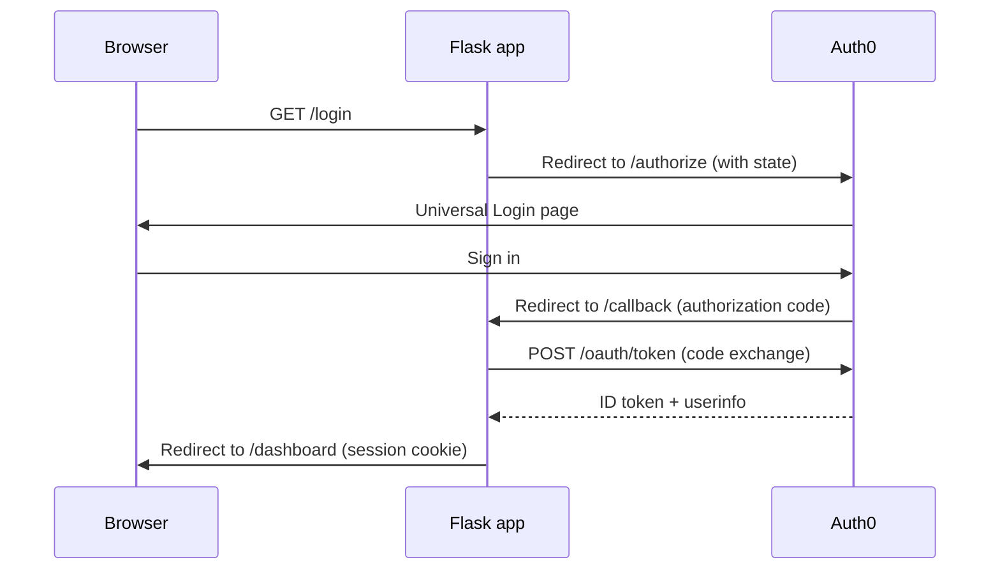

# Auth0 Login Flow Demo (Flask)

A minimal Flask web application that implements a complete Auth0 OpenID Connect
login flow: hosted Universal Login, authorization-code callback handling,
session-backed state, and standards-compliant OIDC logout.

Built for MLH Global Hack Week: Builders Week.

## How it works



The app never stores tokens server-side; the authenticated session holds only
the verified ID-token claims.

## Routes

| Route       | Purpose                                                            |
| ----------- | ------------------------------------------------------------------ |
| `/`         | Landing page                                                        |
| `/login`    | Starts the OIDC authorization code flow                             |
| `/callback` | Exchanges the code for tokens and creates the session               |
| `/dashboard`| Protected route showing verified profile claims                     |
| `/logout`   | Clears the local session and performs OIDC logout via `/v2/logout`  |

## Configuration

| Variable              | Description                                        |
| --------------------- | -------------------------------------------------- |
| `AUTH0_DOMAIN`        | Tenant domain, e.g. `dev-xxxx.us.auth0.com`        |
| `AUTH0_CLIENT_ID`     | Application Client ID                              |
| `AUTH0_CLIENT_SECRET` | Application Client Secret                          |
| `SECRET_KEY`          | Flask session signing key (any long random string) |
| `PORT`                | Optional. Defaults to `3000`                       |

## Setup

### 1. Auth0 dashboard

1. Sign in at [manage.auth0.com](https://manage.auth0.com) (free plan is fine).
2. **Applications -> Create Application** -> type **Regular Web Application**.
3. In the application's **Settings** tab:
   - **Allowed Callback URLs**: `http://localhost:3000/callback`
   - **Allowed Logout URLs**: `http://localhost:3000`
   - **Allowed Web Origins**: `http://localhost:3000`
4. Save, then copy **Domain**, **Client ID**, and **Client Secret**.

### 2. Environment

```bash
cp .env.example .env
# fill in the four required values from the Auth0 dashboard
```

### 3. Run

```bash
python -m venv venv && source venv/bin/activate
pip install -r requirements.txt
python app.py
```

Open [http://localhost:3000](http://localhost:3000), click **Log in with
Auth0**, and you are returned to the dashboard with your verified claims.

## Security notes

- The authorization request carries a `state` parameter; Authlib verifies it on
  callback to protect against CSRF.
- Session cookies are `HttpOnly` and `SameSite=Lax`.
- Missing configuration fails fast at startup with a clear error instead of
  running with insecure defaults.
- The callback route logs and recovers from failed exchanges instead of
  surfacing a raw 500.

## Tech stack

Flask, Authlib (OIDC client), python-dotenv.

## License

MIT — see [LICENSE](LICENSE).
